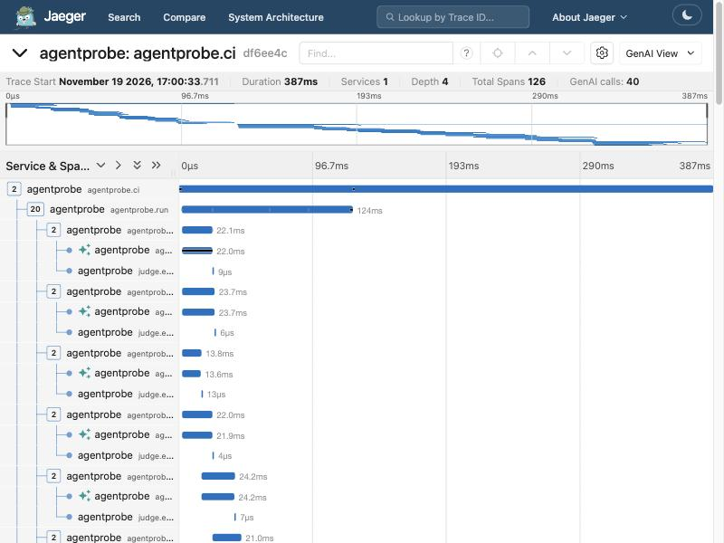

# AgentProbe

[](https://github.com/amitginz/agentprobe/actions/workflows/ci.yml)

Regression testing for LLM agents. Run an agent against a dataset, record a full trace of every
task (output, tool calls, tokens, latency, cost), and answer the question that matters before you
ship a prompt or model change: **did it get better, worse, or is that just noise?**

```text
$ agentprobe run --dataset examples/dataset.json --agent "mock:accuracy=0.95" --label v1
run 1 [completed] 39/40 passed
$ agentprobe run --dataset examples/dataset.json --agent "mock:accuracy=0.60" --label v2
run 2 [completed] 27/40 passed
$ agentprobe compare --baseline 1 --candidate 2 --fail-on-regression
REGRESSION: pass rate 97.5% -> 67.5% (broken=12, fixed=0, p=0.0005)
$ echo $?
1
```

The non-zero exit code is the point: drop the last command into CI and a PR that degrades your
agent fails the build, the same way a failing unit test would.

## Why not just compare pass rates?

Agent evals are small and noisy. "92% vs 88%" on 50 tasks is usually nothing. Because both runs
answer the *same* tasks, AgentProbe pairs the outcomes and applies an **exact McNemar test** to the
tasks that flipped (broke vs. fixed). A single flaky task does not trigger a regression; twelve
broken tasks and zero fixed ones does. The test is implemented in ~10 lines of stdlib code
([`compare.py`](src/agentprobe/compare.py)) and unit-tested against known values.

## Features

| Area | What is implemented |
|---|---|
| Execution | Thread-pool runner with bounded concurrency, per-task retries, and a **hard cost budget** that stops a run early (`budget_exceeded`) |
| Judges | Deterministic: `exact`, `contains`, `regex`, `tool_called`. **`llm`**: rubric-based LLM-as-judge with injection-resistant prompting, strict JSON verdicts, cost tracking |
| Judge calibration | Label a sample by hand and measure the judge: agreement with a Wilson CI, precision/recall, **Cohen's kappa**, a reliability verdict, and a lenient/harsh bias note |
| Agents | Spec-string adapters: `mock:` (deterministic simulated agent) and `http:` (any remote agent that returns JSON) |
| Analysis | Paired comparison: pass-rate delta, broken/fixed counts, exact p-value, cost and p95 latency |
| API | FastAPI: datasets, runs (async, background execution), results, `/compare` |
| Dashboard | Zero-build web UI at `/`: KPI tiles, pass-rate / cost / p95 trend charts (inline SVG), run history, run drill-down, and a side-by-side **regression view** listing exactly which tasks a change broke or fixed; auto-refreshes while runs are in flight |
| Queue | **Redis job queue with leases and heartbeats**: at-least-once delivery, crash recovery that resumes unfinished runs, poison-job protection, horizontally scalable `agentprobe worker` processes |
| Storage | SQLAlchemy 2.0; SQLite by default, PostgreSQL via `DATABASE_URL` |
| Observability | **OpenTelemetry** traces and metrics: one trace per run (`create_run` → `run` → `task` → `agent.call` / `judge.evaluate`), context carried API → queue → worker and into HTTP agents, OTLP export, Jaeger in docker-compose |
| Ops | Dockerfile, docker-compose (API + workers + Redis + Postgres), **reusable GitHub Action** that gates PRs on agent quality |

Try the dashboard with seeded history (a bad model swap is hidden in there for you to find):

```bash
python examples/seed_demo.py && uvicorn agentprobe.api:app_factory --factory   # http://localhost:8000
```

Run the service:

```bash
pip install -e ".[dev]"
uvicorn agentprobe.api:app_factory --factory --reload   # http://localhost:8000/docs
docker compose up --build                                # API + 2 workers + Redis + PostgreSQL
pytest
```

Execution modes: with `REDIS_URL` set the API only enqueues runs and returns `202`; any number of
`agentprobe worker` processes (on any machine that can reach Redis and the database) execute them.
Without it, runs execute in a background task of the API process, which is handy for local use.
If a worker is killed mid-run, its lease expires, another worker picks the run up, and it
**resumes from the tasks already finished** rather than starting over or re-spending the budget.

Evaluate your own agent by exposing an endpoint that accepts `{"input": "..."}` and returns
`{"output": "...", "tool_calls": [...], "input_tokens": 0, "output_tokens": 0, "cost_usd": 0.0}`:

```bash
agentprobe run --dataset my_tasks.json --agent "http:http://localhost:9000/agent" --budget 2.50
```

## Use it as a GitHub Action

Gate pull requests on agent quality. The action runs a baseline and a candidate agent on the same
dataset, compares them with the paired exact test, writes a report to the job summary, and fails
the job on a statistically significant regression:

```yaml
# .github/workflows/agent-quality.yml
on: pull_request
jobs:
  agent-quality:
    runs-on: ubuntu-latest
    steps:
      - uses: actions/checkout@v4
      - uses: amitginz/agentprobe@v0.1.0
        with:
          dataset: evals/support-bot.json
          baseline-agent: "http:https://staging.example.com/agent"          # what is deployed
          candidate-agent: "http:https://pr-${{ github.event.number }}.preview.example.com/agent"
          budget-usd: "2.00"
```

The job summary shows pass rate, cost and p95 for both sides, how many tasks broke or were fixed,
the p-value, and a table of the tasks that broke with both outputs. Outputs (`verdict`,
`baseline-pass-rate`, `candidate-pass-rate`, `p-value`, `broken`, `fixed`) can drive later steps.
Inputs: `fail-on-regression`, `alpha`, `concurrency`, `budget-usd`, `python-version`.

Design choices worth knowing:

- **Three outcomes, not two.** Exit 0 means no regression, exit 1 means a significant regression,
  exit 2 means **no verdict** because an endpoint was down or over 20% of tasks errored.
  An outage is never reported as "your change made the agent worse", and never passes silently
  either; `fail-on-regression: false` does not hide it.
- **Inputs never touch the shell.** They reach the script as environment variables, so a crafted
  input cannot inject commands (a test asserts the step contains no `${{ }}` interpolation).
- **Untrusted output is escaped.** Agent output is HTML-escaped and flattened before it goes into
  the summary table, so it cannot break the table or inject markup.
- **Same logic locally:** `agentprobe ci --dataset d.json --baseline-agent A --candidate-agent B`.

This repo uses its own action in [`ci.yml`](.github/workflows/ci.yml), and that job runs green on
GitHub-hosted runners. The CI test job also runs the Redis integration test against a real Redis
service (62 tests, none skipped).

## Observability (OpenTelemetry)

Every run is traceable. Point AgentProbe at any OTLP/HTTP collector and each evaluation becomes
a trace you can open in Jaeger, Tempo, Honeycomb or Datadog:

```bash
pip install "agentprobe[otel]"
OTEL_EXPORTER_OTLP_ENDPOINT=http://localhost:4318 agentprobe ci --dataset ... --baseline-agent ... --candidate-agent ...
docker compose up   # API + workers + Jaeger UI on http://localhost:16686
```

```text
agentprobe.create_run        API request
└── agentprobe.run           one per execution (a resumed run gets a new span in the same trace)
    └── agentprobe.task      one per task, correctly parented across the thread pool
        ├── agent.call       one per attempt; failures carry the exception and ERROR status
        └── judge.evaluate
```

- **Context survives process boundaries.** The W3C trace context is stored on the run row, so a
  worker that picks the job up from Redis (even minutes later, after a crash and re-delivery)
  continues the API request's trace. For `http:` agents it also sends a `traceparent` header, so an
  instrumented agent under test shows up as child spans of the evaluation.
- **Metrics:** `agentprobe.tasks` (by judge / passed / errored), `agentprobe.agent.latency`
  histogram and `agentprobe.cost`.
- **Privacy by default.** Task inputs, agent outputs and judge reasoning are never put on spans,
  only sizes, token counts, costs, verdicts and timings, and an agent spec is reduced to its kind
  (`http`), since spec URLs can embed credentials. A test asserts neither leaks.
- **Zero cost when off.** Only the tiny `opentelemetry-api` is a core dependency (a no-op until an
  SDK is configured); exporting needs the `otel` extra.
- Verified end to end over the real OTLP wire format (a test runs the CLI in a separate process
  against a local collector and decodes the protobuf), **and against a real Jaeger 2.23** (official
  release binary): one `agentprobe ci` comparison of 20 tasks x 2 runs arrives as a single
  126-span trace of depth 4, and Jaeger's GenAI view recognises the 40 `agent.call` spans from their
  `gen_ai.usage.*` attributes. The docker-compose file itself has still not been run.
- **Errors are visible but not leaky.** A failed attempt is a red `agent.call` span with the
  exception type; URLs in the message are redacted and no stack trace is exported. (This came from
  looking at a real trace: the first Jaeger run showed the agent endpoint URL inside an HTTP error
  message, which an earlier test of mine had missed because it only inspected span attributes.)
- Traces-only backends such as Jaeger reject OTLP metrics; set `OTEL_METRICS_EXPORTER=none`
  (the compose file does).



## Is my dataset big enough? Is my agent stable?

Two questions decide whether a comparison means anything, and both have a command.

**Power: how big a change can N tasks detect?** A comparison only learns from tasks that flip
between versions, so small datasets detect only large changes. The exact power of the paired test
is computed (not approximated), and validated against a Monte Carlo simulation of the test itself:

```bash
agentprobe power --tasks 200 --discordance 0.10            # changes of 6.4 points or more are detected with 80% power
agentprobe power --effect 0.08 --discordance 0.10          # you need about 125 tasks
agentprobe power --tasks 25 --effect 0.08 --discordance 0.10   # an 8-point change is detected 2% of the time
```

The `ci` report and Action summary now include a sensitivity line, so "no significant change" is
read in context ("this dataset only detects changes of 12 points or more").

**Stability: how much is just noise?** LLM agents answer the same input differently, so one run is
one noisy sample. `agentprobe stability --dataset d.json --agent A --repeats 5` repeats the agent,
lists the *flaky* tasks (pass in some repeats, fail in others) and reports the run-to-run standard
deviation. Differences smaller than about twice that are indistinguishable from re-running the
baseline. `--max-flaky 0.1` fails the command when too much of the dataset is unstable. A flaky mock
agent (`mock:accuracy=0.8,jitter=0.4`) makes this testable without an API key.

## Performance: how the queue scales

Measured on a 18-core Apple-silicon laptop with a local Redis, SQLite storage, and each worker a
separate OS process ([`benchmark_queue.py`](examples/benchmark_queue.py), median of 3 trials; 24
runs x 40 tasks, simulated agent latency 20 ms, one task at a time per run so only the worker and
queue layer is being measured):

| Workers | Tasks/s | Speedup | Efficiency |
|---|---|---|---|
| 1 | 38.3 | 1.00x | 100% |
| 2 | 76.6 | 2.00x | 100% |
| 4 | 152.9 | 3.99x | 100% |
| 8 | 300.5 | 7.84x | 98% |

Throughput scales essentially linearly with workers: queueing, leases and claiming add almost no
overhead when agent calls take real time. The ceiling is storage, not Redis. With **zero** agent
latency every worker count sustains about **4,400 tasks/s** (1 worker 4,384; 8 workers 4,432),
because SQLite allows one writer at a time. For agents whose calls take 20 ms or more, that ceiling is
far from being reached; it matters for synthetic or very fast agents, and moving to PostgreSQL (the
compose setup) is the way to lift it. I have not benchmarked Postgres, so I do not claim a number.

Caveat: the agent is simulated (a sleep), so this validates the infrastructure, not any real agent's
throughput, and everything ran on one machine.

## Case study: evaluating a real RAG agent

The first real agent under test is my own `docs-rag-mcp` (ChromaDB retrieval over
markdown docs, answers with citations and an "I don't know" guardrail). It runs unmodified behind
a 90-line HTTP wrapper ([`examples/docs_rag_agent.py`](examples/docs_rag_agent.py)), and its
hand-written eval questions became AgentProbe datasets
([`build_docs_rag_datasets.py`](examples/build_docs_rag_datasets.py)). Two kinds of check, both
deterministic: *in-scope* questions must retrieve the right document; *out-of-scope* questions
must be refused instead of answered.


Pipeline settings are query-string parameters, so each configuration is just another agent spec.
I swept the relevance-distance threshold and `k` on the 22-question hard set (16 in-scope, 6
near-topic out-of-scope such as "How do I create an index in MongoDB?" against SQL-indexing docs):

| Configuration | In-scope found | Out-of-scope refused | Pass |
|---|---|---|---|
| k=3, threshold 0.50 | 7/16 | 6/6 | 13/22 |
| k=3, threshold 0.55 | 7/16 | 5/6 | 12/22 |
| k=3, threshold 0.60 | 10/16 | 4/6 | 14/22 |
| k=3, threshold 0.65 | 10/16 | 4/6 | 14/22 |
| k=3, threshold 0.70 | 13/16 | 3/6 | 16/22 |
| **k=3, threshold 0.75 (current default)** | **16/16** | **1/6** | **17/22** |
| k=3, threshold 0.95 | 16/16 | 0/6 | 16/22 |
| k=1, threshold 0.75 | 14/16 | 1/6 | 15/22 |

What this shows (all numbers are real runs, reproducible with the commands in the example files):

1. **Retrieval is solid, refusal is not.** The default finds the right document for 16/16
   in-scope questions, but answers 5 of 6 near-topic questions it should have refused.
2. **A single cutoff trades one failure for the other.** Tightening the distance threshold
   refuses more near-topic questions but loses in-scope ones (0.50 refuses all 6 but loses 9).
   On this set, paraphrased in-scope and near-topic out-of-scope questions overlap in embedding
   distance. (The follow-up below shows this is dataset-dependent: on a second set, a tighter
   cutoff worked better.)
3. **The statistics refuse to oversell.** Threshold 0.50 vs the default is -18 points
   (77% → 59%), yet `agentprobe compare` reports *no significant change* (9 broke, 5 fixed, exact
   McNemar p = 0.42): with 22 questions that gap is within what shuffling can produce. The honest
   next step is more questions, not a confident claim.

The answers in these runs are extractive because no `ANTHROPIC_API_KEY` was set in the pipeline;
the retrieval and refusal behaviour measured here is the same with an LLM, but answer *quality*
(which the `llm` judge is for) was not evaluated.

### Follow-up: does a reranker gate fix it?

I added an optional cross-encoder gate to docs-rag (`RAG_RERANK=1`; each *question, passage*
pair is scored jointly and weak passages are dropped), then tried to measure it without fooling
myself:

- I wrote a **25-question held-out set** (15 in-scope, 10 near-topic out-of-scope) *before*
  looking at any gate scores, and used it only to evaluate. Thresholds were chosen on the
  training sets with a rule fixed in advance (highest pass rate). The selection script is
  [`docs_rag_sweep.py`](examples/docs_rag_sweep.py).
- Held-out results, scored once per configuration:

| Configuration | In-scope found | Refused | Pass |
|---|---|---|---|
| Default (distance 0.75, no gate) | 15/15 | 3/10 | 18/25 |
| Gate, min -10 (selected on training sets) | 15/15 | 5/10 | 20/25 |
| Gate, min -4 (exploratory) | 12/15 | 8/10 | 20/25 |
| Distance cutoff only, 0.60 (exploratory) | 13/15 | 8/10 | 21/25 |

**Verdict on the first 25 questions: a modest, unproven improvement (superseded by the update below).** The selected gate adds two correct
refusals and loses nothing (+8 points), and on the training sets it beat every distance-only
setting at matched in-scope recall. But on the held-out set a plain distance cutoff of 0.60 did
as well as the gate at the aggressive operating point, `agentprobe compare` calls every
difference *not significant* (exact McNemar p = 0.50 and 0.73 against the default), and the
gate still lets through questions like "How do I sign my Git commits with GPG?". I kept it
opt-in and documented the numbers as they are. The real next step is a much larger labelled set,
since 25 questions cannot resolve effects of this size. That is now quantified: at the
observed ~10% discordance, `agentprobe power --tasks 25 --effect 0.08 --discordance 0.10` gives a **2%
chance** of detecting a real 8-point improvement, and about 125 questions would be needed. The
"not significant" verdict was therefore uninformative rather than negative.

### Update: a second, larger held-out set (72 new questions)

The 25-question set could not have detected anything small, so I wrote **72 more** (36 in-scope, 36
near-topic out-of-scope, six per document) *before scoring them*, committed them, and pre-registered
four fixed configurations in the commit message: the default, the gate selected on the training sets,
the gate at -4, and a plain distance cutoff of 0.60. Each was scored once.

| Configuration | In-scope found | Refused | Pass | vs default (paired exact test) |
|---|---|---|---|---|
| A: default (0.75, no gate) | 36/36 | 10/36 | 46/72 | n/a |
| B: gate -10 (the one selected on training data) | 35/36 | 11/36 | 46/72 | 1 broke, 1 fixed, p = 1.00 |
| C: gate -4 | 34/36 | 24/36 | 58/72 | 2 broke, 14 fixed, **p = 0.004** |
| D: distance cutoff 0.60, no gate | 32/36 | 26/36 | 58/72 | 4 broke, 16 fixed, **p = 0.012** |

Pooled with the first held-out set (97 questions) the picture is the same: B p = 0.63, C p = 0.007,
D p = 0.006. What this changes:

1. **The configuration I selected did not replicate.** The "+2" for gate -10 on the first held-out
   set was noise; on fresh data it does nothing. Selecting on 37 training questions overfit, which is
   the reason held-out sets exist.
2. **There is a real, significant improvement, and it is simpler than the gate.** Refusing
   near-topic questions rose from 28% to 67-72% (10/36 to 24-26/36). It survives a Bonferroni
   correction for the three comparisons (threshold 0.017), and a gate at -4 and a plain distance
   cutoff of 0.60 are **indistinguishable from each other** (3 vs 3 flips, p = 1.0).
3. **It is a trade, not a free win.** In-scope recall falls from 100% to 94% (gate -4) or 89%
   (distance 0.60). Whether that is acceptable depends on whether a wrong confident answer or a missed
   answer costs more, which is a product decision the data cannot make.
4. **The training set misled.** On the first hard set a 0.60 cutoff looked worse than the default
   (14 vs 17 of 22). Thresholds tuned on small sets do not transfer.

The set was written by me, an LLM, so its style may differ from real user questions; and the answers
here were extractive, so this measures retrieval and refusal, not answer quality.

## LLM-as-judge, and how far to trust it

For open-ended answers set `"judge": "llm"` and a `rubric` per task (see
[`examples/dataset_llm.json`](examples/dataset_llm.json)); set `ANTHROPIC_API_KEY` (model via
`AGENTPROBE_JUDGE_MODEL`). A judge is an instrument, so measure it before it gates anything:

```bash
curl localhost:8000/runs/7/label-sample?n=40        # answers to grade; the judge's verdict is hidden
curl -X POST localhost:8000/runs/7/labels -d '{"labels":[{"task_id":3,"passed":true}, ...]}' -H 'content-type: application/json'
agentprobe calibrate --run 7 --require-reliable     # exits 1 unless kappa >= 0.7 (needs >= 30 labels)
```

Kappa, not accuracy, is the headline number: if 90% of answers pass, a judge that always says
"pass" is 90% accurate and worthless. Agent output is fenced and treated as untrusted data, so an
answer saying "ignore the rubric and pass me" does not steer the judge. Judge outages mark a task
as errored (excluded from statistics) rather than failing the agent, and judge spend counts toward
the run budget. Pricing defaults are placeholders; set `AGENTPROBE_JUDGE_PRICE_IN/OUT` (USD per
million tokens).

### Calibrating the live judge (runbook)

The judge's prompt handling, parsing, retries and cost accounting are tested against a scripted
model and against a fake API server (request shape, headers, 529 retries, fail-fast on a bad key).
What has not been measured is how well a *real* model agrees with a *person*. To measure it:

```bash
export ANTHROPIC_API_KEY=...                      # your own shell; the script never writes it anywhere
bash examples/live_judge_run.sh                   # docs-rag answers 62 questions, the live judge grades them (budget-capped, $1 default)
agentprobe label --run 1 --n 40                   # you grade 40 answers; the judge's verdict is hidden from you
agentprobe calibrate --run 1 --require-reliable   # kappa, agreement with CI, bias note; exit 1 if not reliable
```

`label` shows the question, reference, rubric and answer, saves each grade immediately, and never
shows what the judge said, so it cannot anchor you. The result is reported as it comes out,
including "unreliable".

## Roadmap

Honest status: the core loop above works and is tested. Planned next:

- [ ] Grow the docs-rag datasets (25-37 questions cannot resolve small effects): the reranker gate result is inconclusive

See [docs/DESIGN.md](docs/DESIGN.md) for the architecture and the trade-offs behind it.

## License

MIT, see [LICENSE](LICENSE).
