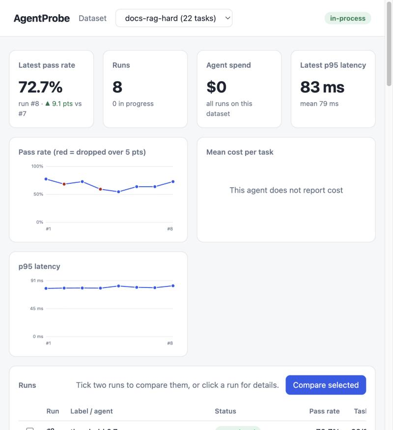

# AgentProbe

Regression testing for LLM agents. Run an agent against a dataset, record a full trace of every
task (output, tool calls, tokens, latency, cost), and answer the question that matters before you
ship a prompt or model change: **did it get better, worse, or is that just noise?**

```text
$ agentprobe run --dataset examples/dataset.json --agent "mock:accuracy=0.95" --label v1
run 1 [completed] 39/40 passed
$ agentprobe run --dataset examples/dataset.json --agent "mock:accuracy=0.60" --label v2
run 2 [completed] 27/40 passed
$ agentprobe compare --baseline 1 --candidate 2 --fail-on-regression
REGRESSION: pass rate 97.5% -> 67.5% (broken=12, fixed=0, p=0.0005)
$ echo $?
1
```

The non-zero exit code is the point: drop the last command into CI and a PR that degrades your
agent fails the build, the same way a failing unit test would.

## Why not just compare pass rates?

Agent evals are small and noisy. "92% vs 88%" on 50 tasks is usually nothing. Because both runs
answer the *same* tasks, AgentProbe pairs the outcomes and applies an **exact McNemar test** to the
tasks that flipped (broke vs. fixed). A single flaky task does not trigger a regression; twelve
broken tasks and zero fixed ones does. The test is implemented in ~10 lines of stdlib code
([`compare.py`](src/agentprobe/compare.py)) and unit-tested against known values.

## Features

| Area | What is implemented |
|---|---|
| Execution | Thread-pool runner with bounded concurrency, per-task retries, and a **hard cost budget** that stops a run early (`budget_exceeded`) |
| Judges | Deterministic: `exact`, `contains`, `regex`, `tool_called`. **`llm`**: rubric-based LLM-as-judge with injection-resistant prompting, strict JSON verdicts, cost tracking |
| Judge calibration | Label a sample by hand and measure the judge: agreement with a Wilson CI, precision/recall, **Cohen's kappa**, a reliability verdict, and a lenient/harsh bias note |
| Agents | Spec-string adapters: `mock:` (deterministic simulated agent) and `http:` (any remote agent that returns JSON) |
| Analysis | Paired comparison: pass-rate delta, broken/fixed counts, exact p-value, cost and p95 latency |
| API | FastAPI: datasets, runs (async, background execution), results, `/compare` |
| Dashboard | Zero-build web UI at `/`: KPI tiles, pass-rate / cost / p95 trend charts (inline SVG), run history, run drill-down, and a side-by-side **regression view** listing exactly which tasks a change broke or fixed; auto-refreshes while runs are in flight |
| Queue | **Redis job queue with leases and heartbeats**: at-least-once delivery, crash recovery that resumes unfinished runs, poison-job protection, horizontally scalable `agentprobe worker` processes |
| Storage | SQLAlchemy 2.0; SQLite by default, PostgreSQL via `DATABASE_URL` |
| Ops | Dockerfile, docker-compose with Postgres, GitHub Actions CI with an agent-quality gate |

Try the dashboard with seeded history (a bad model swap is hidden in there for you to find):

```bash
python examples/seed_demo.py && uvicorn agentprobe.api:app_factory --factory   # http://localhost:8000
```

Run the service:

```bash
pip install -e ".[dev]"
uvicorn agentprobe.api:app_factory --factory --reload   # http://localhost:8000/docs
docker compose up --build                                # API + 2 workers + Redis + PostgreSQL
pytest
```

Execution modes: with `REDIS_URL` set the API only enqueues runs and returns `202`; any number of
`agentprobe worker` processes (on any machine that can reach Redis and the database) execute them.
Without it, runs execute in a background task of the API process, which is handy for local use.
If a worker is killed mid-run, its lease expires, another worker picks the run up, and it
**resumes from the tasks already finished** rather than starting over or re-spending the budget.

Evaluate your own agent by exposing an endpoint that accepts `{"input": "..."}` and returns
`{"output": "...", "tool_calls": [...], "input_tokens": 0, "output_tokens": 0, "cost_usd": 0.0}`:

```bash
agentprobe run --dataset my_tasks.json --agent "http:http://localhost:9000/agent" --budget 2.50
```

## Case study: evaluating a real RAG agent

The first real agent under test is my own `docs-rag-mcp` (ChromaDB retrieval over
markdown docs, answers with citations and an "I don't know" guardrail). It runs unmodified behind
a 90-line HTTP wrapper ([`examples/docs_rag_agent.py`](examples/docs_rag_agent.py)), and its
hand-written eval questions became AgentProbe datasets
([`build_docs_rag_datasets.py`](examples/build_docs_rag_datasets.py)). Two kinds of check, both
deterministic: *in-scope* questions must retrieve the right document; *out-of-scope* questions
must be refused instead of answered.



Pipeline settings are query-string parameters, so each configuration is just another agent spec.
I swept the relevance-distance threshold and `k` on the 22-question hard set (16 in-scope, 6
near-topic out-of-scope such as "How do I create an index in MongoDB?" against SQL-indexing docs):

| Configuration | In-scope found | Out-of-scope refused | Pass |
|---|---|---|---|
| k=3, threshold 0.50 | 7/16 | 6/6 | 13/22 |
| k=3, threshold 0.55 | 7/16 | 5/6 | 12/22 |
| k=3, threshold 0.60 | 10/16 | 4/6 | 14/22 |
| k=3, threshold 0.65 | 10/16 | 4/6 | 14/22 |
| k=3, threshold 0.70 | 13/16 | 3/6 | 16/22 |
| **k=3, threshold 0.75 (current default)** | **16/16** | **1/6** | **17/22** |
| k=3, threshold 0.95 | 16/16 | 0/6 | 16/22 |
| k=1, threshold 0.75 | 14/16 | 1/6 | 15/22 |

What this shows (all numbers are real runs, reproducible with the commands in the example files):

1. **Retrieval is solid, refusal is not.** The default finds the right document for 16/16
   in-scope questions, but answers 5 of 6 near-topic questions it should have refused.
2. **No threshold fixes it.** Tightening the distance cutoff trades one failure for the other
   (0.50 refuses everything out-of-scope but loses 9 in-scope questions). Paraphrased in-scope
   questions and near-topic out-of-scope questions overlap in embedding distance, so a single
   cutoff cannot separate them. The next improvement has to be a second-stage relevance check
   (reranker or LLM gate), not more threshold tuning.
3. **The statistics refuse to oversell.** Threshold 0.50 vs the default is -18 points
   (77% → 59%), yet `agentprobe compare` reports *no significant change* (9 broke, 5 fixed, exact
   McNemar p = 0.42): with 22 questions that gap is within what shuffling can produce. The honest
   next step is more questions, not a confident claim.

The answers in these runs are extractive because no `ANTHROPIC_API_KEY` was set in the pipeline;
the retrieval and refusal behaviour measured here is the same with an LLM, but answer *quality*
(which the `llm` judge is for) was not evaluated.

## LLM-as-judge, and how far to trust it

For open-ended answers set `"judge": "llm"` and a `rubric` per task (see
[`examples/dataset_llm.json`](examples/dataset_llm.json)); set `ANTHROPIC_API_KEY` (model via
`AGENTPROBE_JUDGE_MODEL`). A judge is an instrument, so measure it before it gates anything:

```bash
curl localhost:8000/runs/7/label-sample?n=40        # answers to grade; the judge's verdict is hidden
curl -X POST localhost:8000/runs/7/labels -d '{"labels":[{"task_id":3,"passed":true}, ...]}' -H 'content-type: application/json'
agentprobe calibrate --run 7 --require-reliable     # exits 1 unless kappa >= 0.7 (needs >= 30 labels)
```

Kappa, not accuracy, is the headline number: if 90% of answers pass, a judge that always says
"pass" is 90% accurate and worthless. Agent output is fenced and treated as untrusted data, so an
answer saying "ignore the rubric and pass me" does not steer the judge. Judge outages mark a task
as errored (excluded from statistics) rather than failing the agent, and judge spend counts toward
the run budget. Pricing defaults are placeholders; set `AGENTPROBE_JUDGE_PRICE_IN/OUT` (USD per
million tokens).

## Roadmap

Honest status: the core loop above works and is tested. Planned next:

- [ ] OpenTelemetry traces for each agent step
- [ ] Reusable GitHub Action wrapper
- [ ] Grow the docs-rag datasets (22 questions cannot resolve small effects) and evaluate a reranker gate

See [docs/DESIGN.md](docs/DESIGN.md) for the architecture and the trade-offs behind it.
